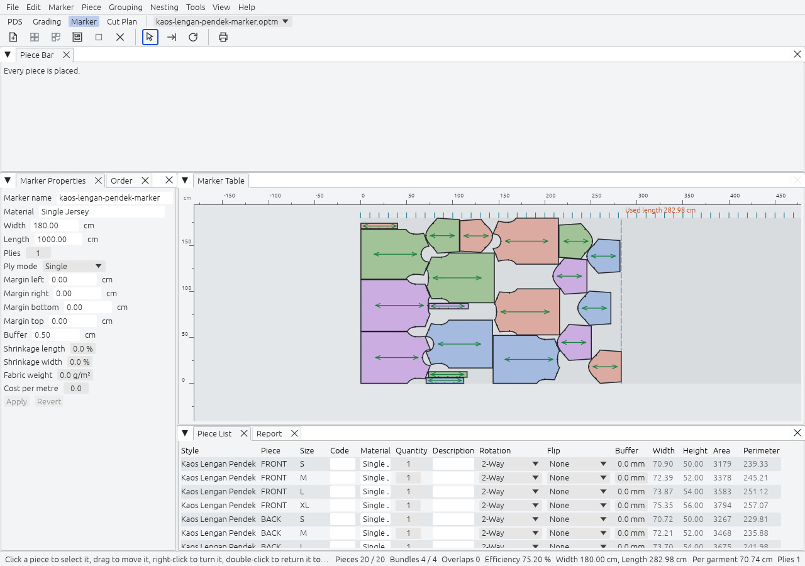
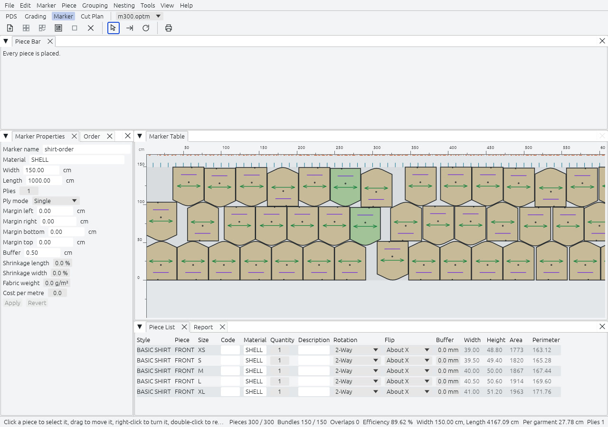

A marker is the arrangement of the pieces of one or more styles and sizes on a fabric of a given width, ready to plot or cut. In this workspace you define the fabric, ask for the garments you need, place the pieces, and read what the arrangement costs in fabric.

## The screen

| Pane | What it holds |
|---|---|
| Marker Table | The fabric band, in the centre. X runs along the marker length, which is the warp, and Y across the width. A line shows the used length with its value. A ruler marks every 10 cm. |
| Pieces | View, Pieces, the first tab on the left. A table per Style with `placed/total` for every piece and size, and a Total row. |
| Piece Bar | The first tab of the bottom panel. One thumbnail per style, piece and size, labelled with the piece name and the count still to place; the tooltip gives piece, Style and size. Drag to reorder: the order seeds the nesting. |
| Piece List | One row per piece and size. Code, material, quantity, rotation, flip, buffer, Max Tilt (°), Folding and the side buffers are editable; coordinates, area and perimeter are read-only. Lengths use the working unit. A typed or dragged number is applied once, on `Enter`, at the end of the drag or when you click away; `Esc` drops it. |
| Marker Definitions | Name, material, width, length, plies, ply mode, margins, buffer, shrinkage, fabric weight, cost per metre and the Total Pieces Area. |
| Order | Bundles per size, and a direction for each size: One Way, Opposite or Any. Typed numbers are applied as in the Piece List. |
| Report | The report before it is written. Marker, Report… shows it again after you close it. |

The Marker Table fills each piece solidly in its size colour, hatches overlaps in red and outlines in orange a piece inside a margin. A fixed piece shows a pin. A new or opened Marker fits the fabric width in view.

The status bar keeps these fields live: cursor position, pieces placed of requested, bundles complete of requested, overlaps, efficiency, width, used length, length per garment, plies, and the progress of a nesting run. It also has the Cut/Plot Order toggle.

## Set up

File, New Marker (`Ctrl+N`) opens one dialog with the Marker Definitions, the Style (the one open in PDS, or a file with Browse), the Material with the pieces one Bundle takes of each, and the Bundles and direction per size. Instead of the whole Style, you can pick one of its Style Sets. Create stays blocked, with its reason, until a Style is chosen and something is ordered.

Marker, Add Style… (`Shift+O`) adds more style files. Each style is embedded in the marker, so the marker keeps working if the style file moves. If the style file changes later, the marker says so and offers Update from Style, which keeps the poses of the pieces that still exist and the embedded Style Set. Its preview and notice count the folded pairs it unfolds, and it names a source file that is missing. Marker, Marker Definitions… (`Ctrl+M`) changes the fabric and the limits as one undo step.

A bundle is the set of pieces that makes one garment of one size. Type the bundles per size in the Order pane. The direction decides how pieces may turn by 180 degrees: One Way keeps every bundle the same, Opposite alternates between bundles, Any is free.

**Ply mode.** Marker Definitions, New Marker and the wizard offer Single, Tubular, Faced and Folded. Faced and Folded hold a pair piece once, since the opposite ply gives its mirror. The ply mode also decides where a pair can lie folded; see [Folded pieces](#folded-pieces).

## Marker Creation Wizard

File, Marker Creation Wizard… makes several Markers in one go. Its steps are Select Style Files, Define Marker Files, Define Quantities (Bundles per Marker and size), Define Table Properties, Define Global Properties (with the buffer), Define Piece Properties (rotation, flip and buffer of each piece) and Finish. A Style file can be embedded as one of its Style Sets. Create Markers opens one unsaved Marker per row. The piece settings go to each Marker's own copy of the Style, never to the Style open in PDS.

## Place by hand

| To | Do this |
|---|---|
| Place a piece | Drag a thumbnail onto the table, or double-click it for the first free spot, bottom left. A click on a thumbnail or a Pieces cell arms placing: the next copy hangs under the pointer as a ghost, hatched red where it would overlap, and each click on the table places it. `Esc` stops. |
| Place many | `P` arms the Place Tool, `Shift+P` places the selected bundles, and Place All places every unplaced piece, bottom-left first. |
| Move it | Drag. Overlaps are allowed and shown. |
| Return it to the bar | Double-click the placed piece, or select it and press `Del`. |
| Rotate | `Shift+R` steps to the next orientation its rules allow, as a right-click does. `F3` or `=` rotates 90°, `F4` or `-` rotates 180°. |
| Flip | Flip X (`Shift+X`) and Flip Y (`Shift+Y`). |
| Shoot | Right-click and drag a direction, then release, or press `Shift+Arrow`. The piece slides until it touches another piece, a margin or the fabric edge, keeping the buffer. |
| Nudge | Arrow keys, or the digits 2, 4, 6 and 8. The step is 1 mm unless Preferences say otherwise. |
| Select a bundle | `Ctrl+K` selects the whole bundle of the selected piece. |
| Fix a piece | Piece, Fix on Marker pins it: it refuses drags, Shoot, nudges and turns, and Auto Nesting leaves it where it is. Unfix Selected and Unfix All free it. |
| Clear the marker | `Ctrl+C` returns every piece to the bar. `Ctrl+Z` brings them back. |

`Z` arms Select.

## Insert to Hole

Piece, Insert to Hole arms a mode beside Select, Shoot and Rotate Piece. Drag a placed piece over a hole with the left or the right button. It takes the nearest free spot where it fits, and turns to any orientation its rules allow if it must. Then it bumps along the drag, like Shoot. The move is one undo step. Insert to Hole refuses a fixed piece, a cluster member and a drop with no fitting hole in reach, and shows a notice. One piece goes per drag. A piece dropped back into the hole it came from drops in even when released a few centimetres off.

## Piece buffers by side

Piece, Edit Piece Buffer… gives a piece more room on some sides than on others. Around is the buffer on every side. Up, Down, Left and Right add to one side of the piece's grain frame, so they turn with the piece; a mirrored copy swaps Up and Down. Convex buffers the convex hull instead of the outline, and Round Corners rounds the buffered corners. A chain gives one run of the cutting line its own width; pick its points One by One or Start-End. Apply to Selected Pieces or Apply to All Pieces makes the change in one undo step.

View, Piece Buffer draws the buffered outline. A piece with no side buffer and no chain nests exactly as before. One buffer serves every size.

## Folded pieces

A pair can lie on the table as one half on the fold, the way it is cut from folded fabric.

- Piece, Foldable Up & Down (`Ctrl+U`), Foldable Left & Right and Not Foldable (`Ctrl+Q`) set the rule of the Marker's copy of the piece.
- Piece, Place Folded offers the four edges and the four corners. Or hold `U`, `D`, `L` or `R` while you drop or double-click a waiting piece; two keys make a corner.
- The ply mode decides the edges. Tubular folds on the top and bottom, Faced on the left and right, and Folded on all four. A corner needs Folded with 4 plies or more, and the right edge needs a Marker length.
- A folded pair is two copies lying as one half on the fold line. They share one shape, so the pair cannot be moved, shot or turned until it is unfolded. Double-click it, or use Piece, Unfold, to return both.

The plot and the cut file draw the half with a fold tick. Auto Nesting leaves folded pieces where they are and does not fold pieces by itself.

## Stripes and plaids

Marker, Stripe Definition… sets the stripes of the fabric on the table: Start X and Y, the distance between vertical stripes and between horizontal stripes, the angle of each, and Stripe Adjust According To Set Only. Its first values come from the Fabric Pattern of the Style. View, Stripes Lines draws the stripes.

A piece takes part when it has a stripe point, the point that sits on a stripe; PDS sets it with Relate Piece To Stripes. Marker, Relate Piece to Stripes… gives a piece its X and Y distance from the stripe, and Grouping, Stripe Adjust Group (`Ctrl+G`) keeps the stripe position of the selected pieces. With Tools, Stripe Adjust on, a piece with a stripe point snaps to the stripes when it is dropped, dragged alone, shot or inserted into a hole, and Auto Nesting places such pieces only on stripe positions. A selection or a cluster moves as dragged, without snapping.

## Tilt

Piece, Tilt Left (`F11`) and Tilt Right (`F12`) turn the selected placed pieces by the Tilt Step of Preferences, Marker, in one undo step. A piece never turns past its Max Tilt, set in degrees in PDS Piece Properties or in the Piece List. Preferences, Marker, Ignore Automatic Tilt Rotations is on by default. Turn it off and Auto Nesting also tries every orientation tilted by its Max Tilt either way.

## Clusters and Fuse Blocks

Grouping, Cluster Pieces freezes the arrangement of two or more placed pieces. A Cluster is selected, dragged, nudged, shot, fixed, returned, placed and nested as one piece. While it waits, the Piece Bar shows it as one thumbnail "Cluster n", placed by double-click or drag. A cluster only translates: turning or flipping a member is refused with a notice. Grouping, Delete Cluster releases the pieces where they lie.

Grouping, Optimum Block Fuse… and Rectangular Block Fuse… ask for the gap around the pieces (0 to 1000 mm, 10 mm first). They make a Fuse Block: a cluster with a border, either a contour that follows the pieces or a rectangle. Auto Nesting keeps other pieces out of the border, the plot draws it, and the cut file cuts the border instead of the pieces, so the block can be fused before the pieces are cut. The second cut file with the block contents and Thrifty Block Fuse are not built.

## Bump and Cut lines

A Bump Line is a vertical or horizontal wall that pieces do not cross during Auto Nesting, the Place commands and Shoot. A Cut Line is a Bump Line that the cut file cuts across the fabric.

- Drag a line out of a table edge, drag it to move it, and right-click it for its menu. Marker, Add Bumpline at Current Marker End adds one at the used length.
- Marker, Bump/ Cut Lines… lists the lines with Coordinate, Line Direction, Hide, Fixed, Cut and No Bump. It also holds the Marker Top and Bottom overcut, Show Bump Lines Description, Minimal Cut Line Segment, and an option that adds a vertical line at the marker end after each Auto Nesting.
- The cut file cuts the Cut lines and leaves out what lies inside the pieces. The plot draws cut lines solid and bump lines dashed.

## Flaws

A Flaw is a rectangle of the fabric that no piece may overlap. Marker, Flaws has:

- **Mark Flaw on the Marker**: drag a rectangle, or give Left, Right, Top and Bottom. Whole Length Flaw and Whole Width Flaw span the marker or the Material.
- **Import Flaws…** from a CSV list with one `x_from,y_from,x_to,y_to` line per flaw, in millimetres. A bad line refuses the file and is named.
- **Remove Pieces Hitting Flaws** and **Delete All Flaws**.

Auto Nesting and the Place commands keep pieces off flaws. Flaws are drawn hatched on the table and are not plotted.

## Texts on the marker

Piece, Internal Text arms the Text Tool. Click the table or a placed piece to add a text, with its Size, Angle and X and Y Position. A text on a piece moves and turns with it, and Apply To All Sizes puts it on every placed copy of the piece. Click a text to edit it, Remove it or Remove All, and drag it to move it. Texts are plotted, never cut.

## Substitute Size and Single Piece Gap

- **Substitute Size For Selected Pieces** (Grouping, Bundles) swaps each selected placed piece with a waiting copy of the same piece in the next size, in one undo step, and the order counts stay right. In the last size, or with no waiting copy, the piece stays where it is and a warning says why.
- **Single Piece Gap** (Tools menu). With a Shoot gap set in Preferences, Marker, Shoot stops that much further from the other pieces, the margins and the bump lines.

## Auto-nesting

Nesting, Start AutoNesting (`Shift+N`) places the pieces for you. The engine is Rajutara's own: it builds no-fit polygons by ring convolution, fills bottom-left, and improves the result by simulated annealing, following the published methods of Burke and others. It runs on worker threads. Its dialog shows the elapsed time against the Time limit, the best length and Efficiency so far and the pieces placed, with Stop (`Esc`, or `Ctrl+Shift+N`), then a summary. The live Efficiency is measured the same way as the result. The document changes once, by one command, when the run ends.

Nesting, Auto Nesting Setup… (`Ctrl+Shift+Alt+N`) holds the settings, and Save keeps them.

| Setting | Default | Meaning |
|---|---|---|
| Algorithm | Advanced | Standard is the engine above. Standard Quick runs only its first passes and compaction. Advanced starts with Standard, then minimises overlaps on the no-fit polygons and returns the better of the two. |
| Time limit | 60 s | A hard wall-clock limit. |
| Efficiency limit | off | Stop early when the marker reaches it. |
| Unlimited marker length | on | Ignore the maximum length while nesting. |
| Keep placed pieces | on | Nest the unplaced pieces around the ones already placed. Fixed pieces stay put even when this is off. |
| Seed | 1 | Makes a run repeatable. |
| Write efficiency log (CSV) | off | Writes `<stem>-nesting.csv`, one row per improvement: `time_s,length_mm,efficiency_pct,placed`. Needs a saved Marker. |
| Save interim markers | off | Rewrites `<stem>-interim.rjm` with the best packing so far, at most once a minute. Needs a saved Marker. |

Advanced is the default since 2.0.0. In the benchmark decision of [ADR-0019](https://github.com/madmouse17/rajutara/blob/main/docs/adr/0019-nesting-engine-v2.md) (five ESICUP garment sets, three seeds, 60 s each) it beat Standard on every set, by 2.54 points of Efficiency on average. Choose Standard for the engine of 1.x; the Auto Nest Queue rows, `@NEST` without `/AL` and `marker_nest` without `algorithm` use Advanced too.

The Grouping part of the dialog keeps the pieces of a garment together. The grouping and lane choices are saved in the Marker; Block Fuse During Nesting and Separate Blocks last for the session.

- **Nesting According To Bundles** gives each Bundle its own area along the marker. Groups According to Sizes does the same per size. Bundles Overlap (Small, Medium, Large) lets the areas overlap.
- **Maintain Piece Orientation Within Bundles** keeps every piece of a Bundle in the same orientation.
- **Horizontal Groups** splits the width into 1 to 6 lanes, for fabric whose shade changes across the width. Each Bundle stays in one lane, and the bundle areas of the lanes run side by side. Horizontal Groups Overlap lets a piece leave its lane by that much.
- **Block Fuse During Nesting** is Regular, Nest Blocks First, Nest Blocks Last, Nest Blocks Only or Nest With No Blocks, with Separate Blocks.

A run that stops on the time limit depends on how fast the machine is. In the release benchmark, 300 pieces nest in 58 s at 90.1 % efficiency. The engine never leaves an overlap in its result, and a separate exact check confirms it.

## Auto Save Of Markers

Nesting, Auto Save Of Markers splits one order over several markers when one is full. With it on and a Marker length set, Start AutoNesting leaves the first packing in the open Marker and nests what did not fit into `<file>-1.rjm`, `<file>-2.rjm` and so on. It stops when every piece is placed or a round places none.

A piece that another of these markers cuts is "cut elsewhere": it is hidden from the Piece Bar, not nested and not counted missing. Save Only Nested Pieces (And Zero Remainders) and Write Log Report To File (one CSV row per saved marker, with a `date_utc` column) are options. The summary lists the files with Open buttons. A batch script reaches the same with `@NEST /SM`.

## Auto Nest Queue

Nesting, Auto Nest Queue… nests several `.rjm` files one after another on one background job, with no Marker open. Add the files with Add Markers…, then give each row its mode in the Advanced column, its Algorithm and Block Fuse mode, a maximum time and an efficiency limit, and press Run. Regular nests every piece again; Continue keeps the placed pieces and nests the waiting ones around them. New rows start as Regular. Each result goes to `<stem>-nested.rjm` beside its input, and the input is never written. A file that fails shows its reason and the queue goes on. Stop saves the running row and leaves the others Pending; a stopped row shows the efficiency and length of the result it saved. Closing the dialog keeps the job running, with a strip that names the row. No queue files are written.

## What the numbers mean

- **Used length**: the largest X of any placed cutting line, plus the right margin.
- **Efficiency**: the area of the placed pieces divided by the width times the used length, in percent.
- **Waste area**: the width times the used length, minus the area placed.
- **Per garment**: the used length divided by the complete bundles placed, counting the garments that the ply mode cuts.

Flaws and bump lines block placement, but they never add to the used length or change the Efficiency.

The sample tee marker reads 253.03 cm used on 180 cm width, 84.10 % efficiency and 63.26 cm per garment.

## Cutting order

The Cutting Order is the order in which the pieces go to the cutter, with the start point and the knife direction of each cut. It is not the Cut Order of a Cut Plan.

- **Marker, Selected Piece Cut Order…** sets one piece's place in the cutting sequence, its start point and its direction (Clockwise or Counter-clockwise). Set to all the same placed pieces applies it to every placed piece of the same kind.
- **Marker, Optimize Cut Order…** orders the cuts nearest-neighbour from the table corner, or from the top of the marker, and can choose each start point.
- **View, Cut/Plot Order**, also a status-bar toggle, numbers the pieces and marks each start.

Without a Cutting Order, every cut runs clockwise from the lowest-left point of the piece.

## Report, plot and cut

File, Report to Excel… (`Ctrl+R`) writes an Excel workbook (`.xlsx`) with one worksheet per section, and File, Print… (`Ctrl+P`) writes a PDF. Both have the same sections: general figures, the order, every piece, and the notches by shape. The order lists each Bundle's Lane, and the pieces list Tilt (°) and Folded. Counts read "1 piece" and "2 pieces", and the date reads "Date (UTC)".

File, Customize Excel Report… has one tab per report table. Each column has Show, Title, Move Up and Move Down, and Restore Defaults brings the default columns back. The choice is kept in the preferences; the Excel and PDF reports follow it, the Report pane on screen does not.

Preferences, Marker, Piece Description sets the label of each placed piece: the fields (Style Name, Piece Name, Code, Size, Bundle, Material, Description Text) in the order you set, Multi-Line Piece Description, Separator, Alphabetical Bundle Names, Don't Reset Bundle Numbering for Each Size, Orientation Next to Bundle Number, Auto Adjust Description Text and Show Piece Description Text in non-flipped form. The table, the plot, the cut file labels and the DXF export follow it.

File, Plot/Cut… (`Ctrl+L`) offers PDF as A4 tiles, PDF on A0 sheets (tiled along the length when the marker is longer than a sheet), HPGL/2 for a roll plotter, and the cut file. Plots carry a label on each piece, the marker texts and a header block with the marker name, material, width, length and efficiency. The cut file is one generic HPGL/2 file with a pen per element; pen 0 skips an element. It follows the Cutting Order, the start points and the directions, cuts a Fuse Block as its border alone, draws a folded half with a fold tick, and adds the Cut lines. File, Plotter Setup… holds the paper width, offset and calibration.

File, Export to CAD/CAM Files… writes a DXF (release 12, millimetres) of the plot content, with labels as text, one colour per Bundle and one layer per kind of element. Translate piece names prints the names through Tools, Piece Name Dictionary…. [File formats](../../formats/) has the details.

## Not built

- A size picker for Substitute Size: it takes the next size only.
- Quality Text and Exclusive View for the Text Tool, Lock and OpStop for bump lines, and Overlay properties in the wizard.
- Automatic folding by Auto Nesting, and editing the buffer outline point by point.
- The Nesting options Additional Mixing, Optimize Last Bundles and Idle Time.
- Diagonal stripe measurements, stripe colours, Revise Pieces Placements and floral prints.

See the [roadmap](../../roadmap/).
