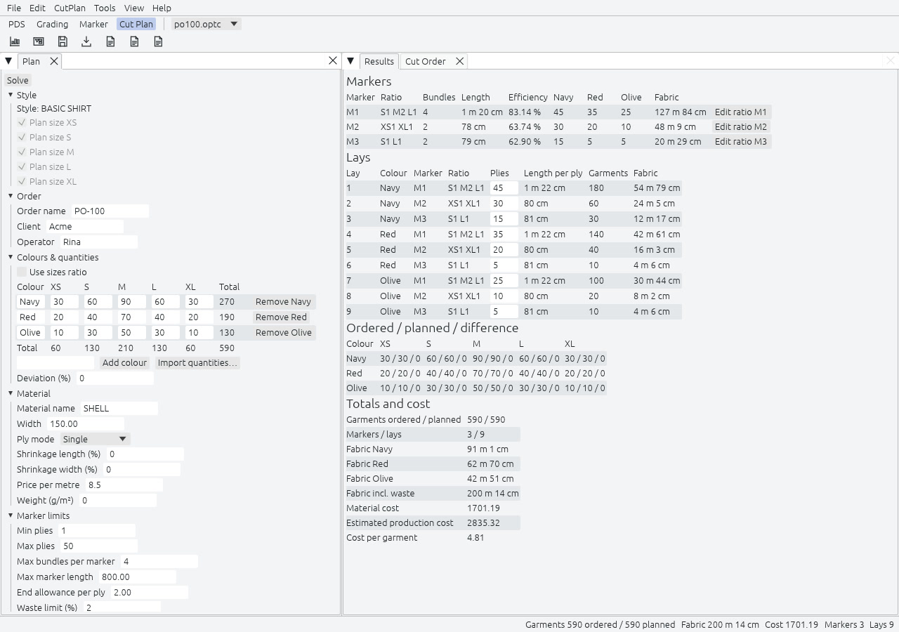

Cut Plan starts from an Order, the garments wanted per colour and size, and plans the Lays that cut it. A Lay is a marker with a ply count. The plan reports the fabric every lay uses and what the whole order costs. The Cut Order then puts the lays in spreading order and draws their plies from your fabric rolls. One plan can hold several Purchase Orders, several Styles and several Materials.

## Create New

Cut Plan, Create New… opens a wizard with the Optitex steps: Adding Style Files, Defining the Order Details, Adding Colors and Defining Quantity for each Size, Defining Material Properties and Defining the Marker. Back, Next, Finish and Cancel move through it; `Enter` goes on and `Esc` cancels. The first step offers the Style open in PDS before a Style file. The plan opens on Finish. An empty Plan, Results or Cut Order pane has a Create New… button too.

A plan saved by Rajutara 1.5.x or older opens as a plan with one Purchase Order. A plan saved by 2.0.0 does not open in 1.5.x.

## The Plan pane

Every step of the wizard stays in the Plan pane, as a list of collapsible sections, so you can come back to any step and solve again.

| Section | Fields |
|---|---|
| Purchase Orders | The POs of the plan, with Add PO, Duplicate PO, Rename and Remove PO. The other sections show the selected PO. |
| Style | The Styles of the plan, each embedded whole or as one Style Set, and the sizes to plan. |
| Order | Order name, client and operator. |
| Colours and quantities | One row per colour, one column per size, with totals. Each colour line names its Style. Ratio mode, deviation, and import from a sheet. |
| Material | Name, width, ply mode, shrinkage, price per metre and weight. |
| Marker limits | Maximum marker length, minimum and maximum plies, maximum bundles per marker, the allowance at the end of each ply, and the waste limit in percent. |
| Cost and efficiency | The efficiency to assume before a marker is nested, the material's share of the production cost, and whether to nest the markers. |

**Ratio mode** takes a ratio per size and a total per colour and spreads the quantities with largest-remainder rounding, so each row adds up to its total. **Deviation** is the over-cut you accept, as a percent of the ordered quantity, per cell: under-cutting is never planned. **Import quantities…** reads a `.csv`, `.xlsx` or `.ods` file, first sheet, with a header row, the colour in the first column and one column per size name.

## Purchase Orders

A plan holds one or more Purchase Orders (POs). Each PO has its own Order, quantities, markers and Lays. Add PO adds one, Duplicate PO copies the selected one, Rename names it and Remove PO deletes it; the last PO cannot be removed.

Viewing the Final Results and Main Algorithm with Nesting act on the selected PO. Solve All POs and Nest All POs act on every PO, each as one undo step. With two or more POs, the Results pane shows a PO comparison above the selected PO's markers and Lays: one column per PO and a Total, with garments ordered and planned, markers, Lays, plies, fabric including waste, efficiency, cost and cost per garment.

## Styles, Materials and Spreading Groups

Cut Plan, Add Style… adds a Style from PDS or from a file, whole or as one of its Style Sets. Cut Plan, Styles and Materials… lists the Styles and the Materials of the plan and adds a Material. A marker never mixes Styles.

Every Material is planned on its own unless a Spreading Group cuts several Materials from one fabric. Cut Plan, Spreading Groups… makes the groups. A group takes the width, shrinkage and cost of its first Material, and its markers hold the pieces of all its Materials.

## Cutting Tables

Cut Plan, Cutting Tables… lists the tables of the cutting room: name, length, minimum and maximum plies, and optionally the one Material or Spreading Group a table serves. A fabric gets the limits of its longest table. The Cut Order puts each Lay on the fitting table with the least fabric spread so far.

When Spreading Groups, Cutting Tables or roll grouping change on a solved plan, the status bar shows "Setup changed: solve again". A click on it runs Solve All POs. The markers of a group left without Materials keep the fabric they were cut from.

## Viewing the Final Results

Press Viewing the Final Results (`F5`) to solve the plan. The solver is a deterministic greedy: for each colour, from the most plies down to the fewest, it picks the ratio of sizes per marker that cuts the most garments that are actually needed, prefers a ratio the plan already uses, and then the one with the least over-cut. Markers with the same ratio in different colours are merged, so there are fewer markers to make. The same inputs always give the same plan, and a plan for ten colours and twelve sizes takes a fraction of a second.

Main Algorithm with Nesting nests each planned marker with the same engine as the Marker workspace, so its real length and efficiency replace the estimate. A marker longer than the limit is flagged "too long", not hidden.

Both check the plan before any nesting. They refuse an ordered piece that is wider than the Material, and name it. A plan file with such a piece still opens, with a warning, so you can widen the Material. While you edit, the Plan pane and the wizard warn when a single Bundle is longer than the maximum marker length; that marker is still kept and flagged "too long".

## Results

| Table | What it shows |
|---|---|
| PO comparison | With two or more POs: one column per PO and a Total. |
| Markers | Marker, ratio such as `S1 M2 L1`, bundles, length, efficiency, plies per colour and the fabric it takes. |
| Lays | Lay number, colour, marker, ratio, plies, length per ply, garments and fabric. The plies are editable. |
| Ordered, planned, difference | Per size and colour. An over-cut is marked with a text badge as well as a colour. |
| Totals and cost | Garments ordered and planned, markers and lays, fabric per colour, fabric including waste, material cost, estimated production cost and cost per garment. An empty order reads 0.00. |

Edit the plies of a lay or the ratio of a marker by hand and the difference table follows. Rajutara then marks the plan as edited and asks before it solves again. For the sample order PO-100, 590 garments in three colours come out as three markers and nine lays.

## Cut Order

The Cut Order tab turns a solved plan into work for the cutting room: the order in which the lays are spread, and the Fabric Rolls each lay draws its plies from.

1. Rajutara groups the lays by colour, in the order of the Order, so each colour change swaps the roll on the spreader once. Within a colour the longest plies come first, since they need long unbroken stretches of fresh roll and the shorter ones can use the ends. With several POs there is one sequence, PO after PO, and the POs share the rolls.
2. It takes each ply whole from a roll of the lay's colour that is at least as wide as the material. It prefers rolls of one shade, so a lay does not mix shades unless no single shade can complete it. Among the rolls that fit, it keeps a roll already on the spreader, then prefers the roll whose leftover would be smallest.
3. A roll's Remnant is what is left after the last ply. If no roll can give a ply, the Cut Order reports the lay, the number of plies and the length missing.

Enter the rolls in the Cut Order pane: code, colour, shade, width and length, or use Import Fabric Rolls… with a `.csv`, `.xlsx` or `.ods` file. A roll of another colour, or a roll narrower than the material, stays unused. Splicing a ply across two rolls is not planned, because whole plies never under-plan. The Cut Order never changes the lays or the markers.

**Roll grouping.** Cut Order setup, Group rolls splits each colour over groups of rolls: By width step, By shrinkage and One shade per group. Each colour's quantities are shared out over its groups in proportion to their fabric, and each group is planned at its own width with its own markers.

## Fabric Room

The Fabric Room is the workshop's inventory of rolls, shared by every plan. Choose its file, `.csv` or `.xlsx`, in Preferences, Cut Plan. Cut Plan, Fabric Room… lists the rolls with code, Material, colour, shade, width, length, shrinkage, supplier, cost per metre and roll weight.

- Add, Remove, Import… and Export… edit the list. To change a row, remove it and add it again.
- Only this plan's materials and colours filters the list.
- Take Rolls copies the selected rows into the plan's rolls.
- Return Remnants asks first, then writes the Cut Order's remnants back: rolls get shorter and lighter, and rolls that are used up are removed.

## Reports

Generating a Cut Plan Report (CSV) writes UTF-8 files, one per section, because CSV has no tabs: the plan's markers, its lays and so on. Generating a Cut Plan Report (PDF) writes the same content on A4. Viewing the Production Report leaves out the costs and adds the garments per lay, for the cutting floor. A plan with rolls adds the Cut Order sections to both, and a plan with Cutting Tables adds the Lays per table. The two imports keep their names, Import quantities… and Import Fabric Rolls…, because Optitex has no import command for them.

With several POs, each section carries the PO name, the reports add the PO comparison, and CSV files are named `<stem>-<po>-<part>.csv`. Save Markers writes `<stem>-<po>-M<n>.rjm`. A one-PO report is the same as in 1.5.

Cut Plan, Customize Report… hides, renames and reorders the columns of every report table. The CSV and the PDF follow the same choice.

## From a script

`rajutara batch` runs a Cut Plan with no window: `@OPENCUTPLAN`, `@SOLVE`, `@NESTMARKERS`, `@CUTPLANREPORT`, `@SAVEMARKERS` and `@SAVECUTPLAN`, with `/PO` to pick one Purchase Order. See [Headless and scripting](../../headless/).
