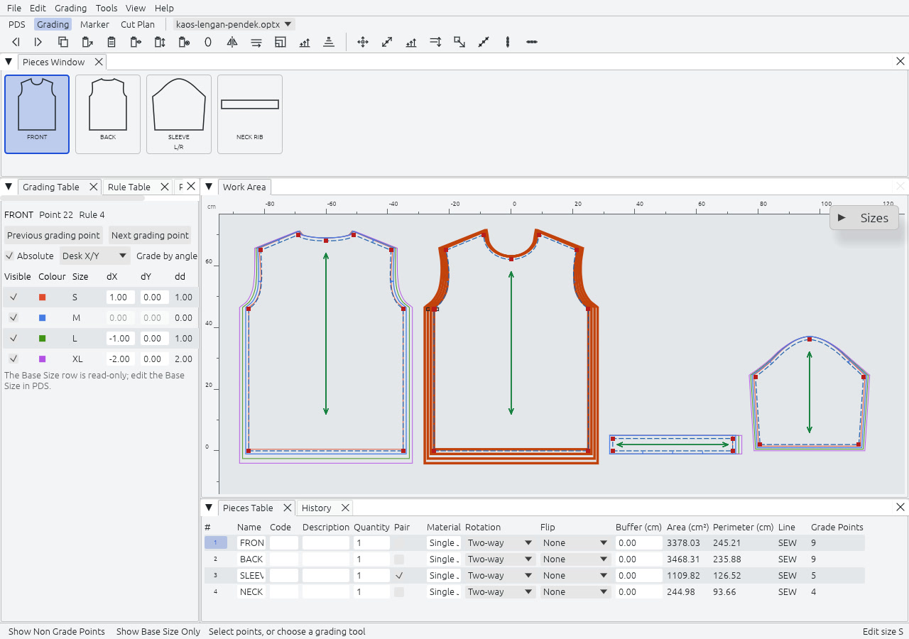

Rajutara grades by rule, the way the point-rule systems of other CAD suites do. A style has a Size Table with exactly one Base Size, and a Grade Rule, a dX and a dY per size, on each Grade Point. A size other than the base is never redrawn: it is derived from the base size by the rules. The base size is the one you draw.

## The screen

Grading is the same style and the same undo history as PDS, with other panes and toolbars. Switching tabs keeps the selection and the zoom. The Pieces Window is the first tab of the bottom panel, so the Work Area keeps most of the window.

| Pane | What it holds | Key |
|---|---|---|
| Work Area | The pieces, with the graded nest visible. | |
| Pieces Window | First tab of the bottom panel, as in PDS. | `1` |
| Grading Table | The rule of the selected grade point: visible, colour, size, dX, dY and dd (the length of the move). | `2` |
| Rule Table | The numbered rules kept with the style. | `Ctrl+Shift+Alt+R` |
| Properties, Pieces Table, History | As in PDS. | `Ctrl+I`, `6` |

`F4` shows the base size only, and `Ctrl+Shift+F4` shows the small, big and base sizes. The Sizes legend can be dragged and collapsed, and it stays inside the Work Area. A graded piece carries the selection mark once, on its Base Size.

## Picking in the Work Area

- **Rectangle selection.** Drag with the Select tool to select a run of points; `Shift` adds to the selection. A hover ring marks the point a click would take, and grab marks show per size while a drag tool is armed.
- **Right-click menus.** The object under the pointer is selected first; a selected run is kept, so Paste reaches all of it.

| Under the pointer | Menu |
|---|---|
| A point | Copy, Paste, Set Grading Tool, Flip, Grade Equally, Clear, Apply Rule |
| A piece | Sizes Table, Set Grading Tool, Stack, Select Grade Points, Create Piece |
| The empty desk | Sizes Table and the view items |

## The size table

`Shift+F4` opens the Sizes Table. It is a dialog because a size edit touches every rule at once.

- Insert or append sizes. The new deltas continue the step of the two nearest sizes, in the middle of the table as well as at the ends.
- Delete the current size, or all sizes but the base.
- Rename sizes and change their order. Names are free text with no whitespace and no meaning to the geometry. Change Size Order moves the colour, line type, thickness and visibility with the name.
- Set Base Size. Every point moves to its position in the chosen size and every rule is re-expressed from it.
- Mark break sizes, then Regrade By Break Size: the sizes between two breaks take the linear interpolation of the breaks. It regrades every unprotected piece, whatever is selected.
- Give each size a colour, a line type and a line thickness (0.05 to 5 mm, 0.25 mm by default). These change only how it is drawn; the Base Size is drawn 0.10 mm thicker.

Rajutara is built for one size dimension of up to 12 sizes. The program accepts up to 99, a cap that protects memory on 32-bit builds.

## The grading table

Select a grade point and its rule appears. Type dX and dY per size. The Absolute switch starts off, as in Optitex: the table shows steps from one size to the next. Tick Absolute to see distances from the base size, which is how the values are stored. A value typed before the switch is applied in the view it was typed in. The Grade by angle selector shows the same numbers along the previous point, the next point or the tangent. Arrow keys move between cells, `Enter` commits one command and `Esc` reverts the cell.

A contour point without a rule of its own moves in proportion between its neighbouring grade points. Its dX and dY cells stay editable: typing a value grades the point and makes it a Grade Point. A typed value is kept when the selection moves on without `Enter`. `Alt+1` toggles a grade point, and removing one deletes its rule after a confirmation.

The table's own menu has Equal All, Zero, Equal, Flip, Copy and Paste. Equal and Equal All take the step from the first, smallest size. Zero, Flip and Equal act on the column you clicked.

## The grading tools

| Group | Tools |
|---|---|
| Copy and paste | Copy Grading (`Shift+C`), Paste Grading (`Shift+V`), Paste X (`Shift+X`), Paste Y (`Shift+Y`), Paste Relatively, Paste Grading Around |
| Set and clear | Set Grading, Flip Grading, Grade Equally, Clear Grading |
| Grade | Grade Along Line, Grade Proportional, Match Segment, Grading Notch Tool |
| Move one size | Move Point Size, Move Size Along, Move Size Proportional, Move Size by Rectangle, Move Size Parallel, Align Points Size, Align Vertical and Horizontal Size, Align Size by Line |
| Stack | Stack Point, Stack by Grainline, Stack Along Line, Restore Stack, Remove Grainline Grading |
| Rules | Rules Library, Apply Rule, Select Grade Points |
| Pieces | Create Piece for Selected Size, Graded Nest |

**Stack Along Line.** Select one contour segment, then choose Grading, Stack, Stack Along Line. Every size is shown with that run centred on the Base Size's run, at the middle of its length, and turned parallel to it. It changes only the view; Restore Stack clears it. With anything other than exactly one contour segment selected, it is disabled and says why. In the Work Area a click near an outline selects that contour segment; a click inside the piece still selects the piece.

**Set Grading** has Last used and Show from Base Size, as in the Optitex Grading Tool dialog. It keeps the last input between openings.

**Move Point Size** moves the size whose point you grab, as Optitex does. The dragged point becomes the selection, so the Grading Table shows its new grading, and the drag shows a band with L, angle, dX and dY. Hold `Shift` to move the larger sizes too, and `Ctrl` for the smaller ones.

## Grading a notch

Grading, Grade, Grading Notch Tool grades the position of a notch. Click a notch, then its previous or its next point. A table shows the notch's distance from that point in every size. Apply grades it in one undo step, and Reset brings back what the Style holds. A notch that sits on a point is refused.

## The graded nest

The Graded Nest view draws every size in its own colour and line thickness, aligned at the Stack Point, and never changes geometry or rules. Graded Nest is also a tool: it builds one graded piece from separate per-size pieces, for a style that was imported with its sizes as separate pieces.

## Exchange

A graded style leaves as an ASTM D6673 DXF of the sample size plus an ASTM RUL file holding the rules, or as a graded nest with one block per size. Both are read back. The RUL syntax is shown in [File formats](../../formats/). Rule tables in Optitex's own format are not read or written.

Multi-dimensional size systems, cross grading by merging style files and measurement charts are Phase 3. See the [roadmap](../../roadmap/).
