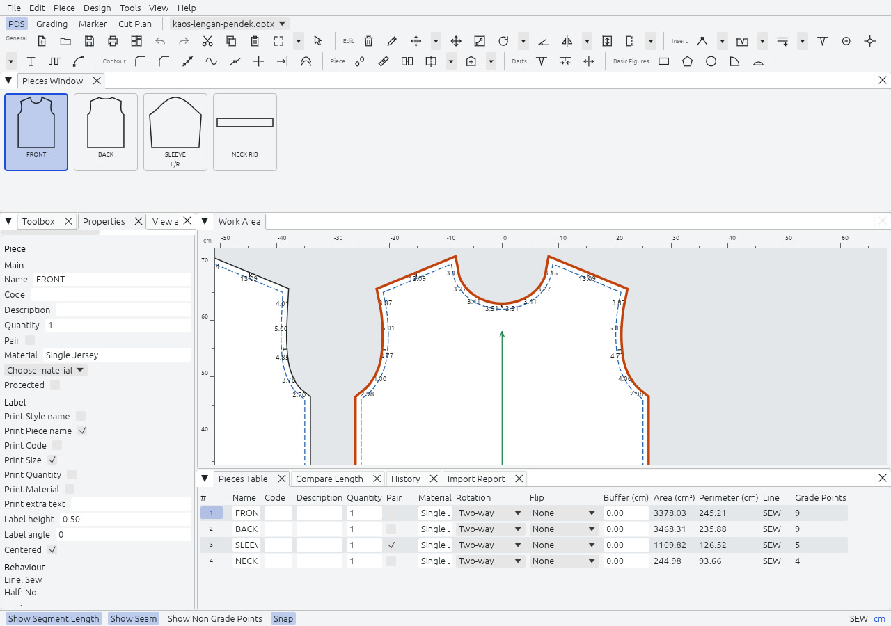

PDS is where pieces come from. Import them from an ASTM or AAMA DXF, or draw them, then edit points, notches, seams and internal lines, check segment lengths, and plot the pieces at 1:1.

## The screen

The panes are dock tabs. Drag a tab to move it, and Tools, Reset Workspace Layout restores the default arrangement. The workspace remembers its own layout.

| Pane | What it holds | Key |
|---|---|---|
| Work Area | The desk where the pieces lie. It cannot be closed. | |
| Pieces Window | One thumbnail per piece, with name, quantity and `L/R` for a pair. Drag one onto the desk, or double-click it. | `1` |
| Toolbox | The tools, grouped as on the toolbars. | `3` |
| Properties | The fields of the selected piece, point or notch. Several pieces edit at once. | `Ctrl+I` |
| View and Selection | What is shown and what can be picked. | `F10` |
| Grading Table | The grade rule of the selected point. | `2` |
| Pieces Table | Every piece in a grid: name, code, quantity, pair, material, rotation, flip, buffer, area, perimeter. | `6` |
| Compare Length | Two runs of a contour, measured against each other. | `5` |
| History | The undo history, shared with the other workspaces. | |
| Import Report | The issues of the last import. It opens when there are any. | |

The status bar toggles segment lengths (`F8`), the seam (`Ctrl+F6`), points that carry no grade rule, the graded sizes (`F4`) and snapping. On the right it shows `Protected` for a locked piece, `SEW` or `CUT` for the line being edited, the unit (click it to cycle centimetres, millimetres and inches) and the cursor position.

## Tools

There are 89 tools, in the groups the toolbars use.

| Group | Examples |
|---|---|
| General | Select (`Z`), zoom and pan, guide lines, piece properties, lock piece (`F3`), cut, copy and paste pieces, merge a style file |
| Piece movement and rotation | Move, rotate (`R`), rotate to horizontal or vertical, flip |
| Grainline and half symmetry | Set the grainline direction (`/`), set a half (`H`), open and close the half (`Shift+H`, `Ctrl+H`) |
| New pieces | Rectangle, polygon, circle, sector and arc pieces, spiral |
| Drafting and points | Draft (`D`), arc (`A`), add a point on the contour (`O`), move a point (`M`), multi move (`Q`) |
| Contour | Align points, round corner, cut corner, smooth, points cleanup |
| Notches and internals | Notch (`N`), notch on a point, text, trim, extend, move and select internal lines |
| Seams | Add seam (`S`), remove seam, reseam, show seam, switch between cut and sew |
| Split, join and fold | Cut, join pieces, join contours, build a piece, trace segments |
| Darts, pleats and fullness | Dart (`Ctrl+Alt+D`), pleat (`L`), add fullness, gusset |

Press `Ctrl+Shift+P` to find a tool by name instead of by key. A tool that needs several clicks shows the next step in the status bar, and `Esc` cancels it. Holding `Alt` while you click opens a dialog for exact values.

Every notch has a shape (V, T, I, L, U or Box), a depth and a width. A grainline is a directed line the marker uses to turn the piece along the fabric. The seam allowance has a width per segment: the cutting contour is the sewing contour plus the allowance.

The [parity checklist](../../parity-checklist/) lists all 89 tools one by one.

## Import and export

File, Import From CAD/CAM Files reads ASTM D6673 and AAMA-292 DXF files, with the RUL file of a graded style. File, Export To CAD/CAM Files writes them back, with a choice between a rule file (the default) and a graded nest. Layer by layer, the DXF is described in [File formats](../../formats/). Rajutara never reads or writes the formats of Optitex itself.

## Plot

`Ctrl+L` opens the Plot dialog.

| Field | Choices |
|---|---|
| Pieces | All, on the desk, or selected. Selected if there is a selection, else on the desk. |
| Sizes | A check list of sizes, and whether to nest the sizes in one outline set. |
| Elements | Cut line, sew line, internal lines, notches, drill holes, grainline, mirror line, annotations, piece label. |
| Target | PDF as A4 tiles (the default), PDF on A0, or an HPGL/2 file. |
| Arrange first | Lays the pieces out on the sheet width before plotting. |

The cut line plots solid and the sew line dashed, notches are drawn as their shape on the cutting line, and the grainline has arrowheads. Arrange for Plot (`Ctrl+K`) does the layout by itself: pieces sorted by height, placed in rows left to right with a gap (10 mm by default), and rotated 90 degrees when a long piece would not fit the width. Plotting runs on a worker thread with progress and a Cancel button.

## Not in 1.0

The Custom seam corner is a disabled button until Phase 3. Wave, Deform Internals, Zones, Equal Segments, Track Lines and the Segment Editor are not mirrored. [Roadmap](../../roadmap/) has the full list.
