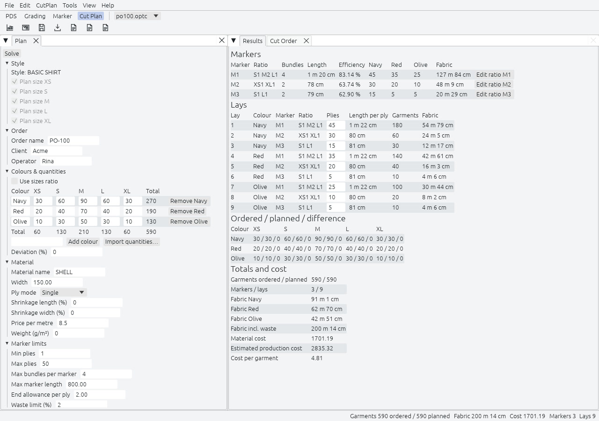

Cut Plan (Rencana Potong) dimulai dari sebuah Order, garmen yang diinginkan per warna dan ukuran, dan merencanakan Lay yang memotongnya dari satu Material. Lay adalah marker dengan jumlah lapis. Rencana melaporkan kain yang dipakai setiap lay dan biaya seluruh order. Cut Order kemudian menyusun lay dalam urutan penghamparan dan mengambil lapisnya dari gulungan kain Anda.

## Panel Plan

Panel ini berupa daftar bagian yang bisa dilipat, jadi Anda bisa kembali ke langkah mana pun dan menyelesaikan ulang.

| Bagian | Bidang |
|---|---|
| Style | Berkas style, tertanam dalam rencana, dan ukuran yang direncanakan. |
| Order | Nama order, klien, dan operator. |
| Colours and quantities | Satu baris per warna, satu kolom per ukuran, dengan total. Mode rasio, deviasi, dan impor dari CSV. |
| Material | Nama, lebar, mode lapis, penyusutan, harga per meter, dan berat. Satu material per rencana. |
| Marker limits | Panjang marker maksimum, lapis minimum dan maksimum, bundle maksimum per marker, kelonggaran di ujung tiap lapis, dan batas limbah dalam persen. |
| Cost and efficiency | Efisiensi yang diasumsikan sebelum marker di-nesting, bagian material dalam biaya produksi, dan apakah marker di-nesting. |

**Mode rasio** mengambil rasio per ukuran dan total per warna lalu membagi jumlahnya dengan pembulatan sisa terbesar, sehingga setiap baris berjumlah sama dengan totalnya. **Deviasi** adalah kelebihan potong yang Anda terima, sebagai persen dari jumlah yang dipesan, per sel: pemotongan kurang tidak pernah direncanakan. **Import quantities** membaca berkas CSV dengan baris judul, warna di kolom pertama dan satu kolom per nama ukuran.

## Solve

Tekan Solve (`F5`). Penyelesainya adalah greedy deterministik: untuk setiap warna, dari lapis terbanyak ke paling sedikit, ia memilih rasio ukuran per marker yang memotong garmen paling banyak yang benar-benar dibutuhkan, mengutamakan rasio yang sudah dipakai rencana, lalu yang kelebihan potongnya paling kecil. Marker dengan rasio sama pada warna berbeda digabung, sehingga ada lebih sedikit marker yang harus dibuat. Masukan yang sama selalu menghasilkan rencana yang sama, dan rencana untuk sepuluh warna dan dua belas ukuran memakan sepersekian detik.

Nyalakan Nest markers dan setiap marker yang direncanakan di-nesting oleh mesin yang sama dengan ruang kerja Marker, sehingga panjang dan efisiensi sebenarnya menggantikan perkiraan. Marker yang lebih panjang dari batas ditandai "too long", tidak disembunyikan.

## Results

| Tabel | Yang ditampilkannya |
|---|---|
| Markers | Marker, rasio seperti `S1 M2 L1`, bundle, panjang, efisiensi, lapis per warna, dan kain yang dipakainya. |
| Lays | Nomor lay, warna, marker, rasio, lapis, panjang per lapis, garmen, dan kain. Lapisnya bisa disunting. |
| Ordered, planned, difference | Per ukuran dan warna. Kelebihan potong ditandai dengan lencana teks selain warna. |
| Totals and cost | Garmen dipesan dan direncanakan, marker dan lay, kain per warna, kain termasuk limbah, biaya material, perkiraan biaya produksi, dan biaya per garmen. |

Sunting lapis sebuah lay atau rasio sebuah marker dengan tangan dan tabel selisih mengikuti. Rencana lalu ditandai sebagai sudah disunting, dan menyelesaikan ulang akan bertanya dulu. Untuk order contoh PO-100, 590 garmen dalam tiga warna menjadi tiga marker dan sembilan lay.

## Cut Order

Tab Cut Order mengubah rencana yang sudah diselesaikan menjadi pekerjaan untuk ruang potong: urutan lay dihampar, dan Fabric Roll tempat tiap lay mengambil lapisnya.

1. **Urutan.** Lay dikelompokkan menurut warna dalam urutan Order, sehingga setiap pergantian warna hanya sekali menukar gulungan di mesin hampar. Dalam satu warna, lapis terpanjang didahulukan, karena memerlukan bentang gulungan segar yang panjang tanpa putus dan yang lebih pendek bisa memakai ujung-ujungnya.
2. **Alokasi gulungan.** Setiap lapis diambil utuh dari gulungan berwarna sama dengan lay yang lebarnya setidaknya sama dengan material. Gulungan dengan shade yang sama diutamakan, sehingga lay tidak mencampur shade kecuali tidak ada satu shade pun yang bisa menyelesaikannya. Di antara gulungan yang cocok, gulungan yang sudah ada di mesin hampar dipertahankan, dan gulungan yang sisanya paling kecil menang.
3. **Sisa dan kain yang kurang.** Remnant sebuah gulungan adalah yang tersisa setelah lapis terakhir. Jika tidak ada gulungan yang bisa memberi satu lapis, Cut Order melaporkan lay, jumlah lapis, dan panjang yang kurang.

Masukkan gulungan di panel Cut Order: kode, warna, shade, lebar, dan panjang. Gulungan warna lain, atau gulungan yang lebih sempit daripada material, tidak dipakai. Menyambung satu lapis lintas dua gulungan tidak direncanakan, karena lapis utuh tidak pernah merencanakan terlalu sedikit. Cut Order tidak pernah mengubah lay atau marker.

## Laporan

Report (CSV) menulis berkas UTF-8, satu per bagian, karena CSV tidak punya tab: marker rencana, lay-nya, dan seterusnya. Report (PDF) menulis isi yang sama di A4. Production Report menghilangkan biaya dan menambahkan garmen per lay, untuk lantai pemotongan. Rencana dengan gulungan menambahkan bagian Cut Order ke keduanya.

## Belum ada di 1.0

Grup penghamparan yang mencampur material, inventaris gudang kain yang dipakai bersama antarrencana, grup gulungan menurut lebar dan penyusutan dengan marker sendiri, beberapa meja potong per material, dan beberapa style dalam satu rencana dijadwalkan untuk Fase 3. Menjalankan Cut Plan dari baris perintah tidak direncanakan. Lihat [peta jalan](../../roadmap/).
