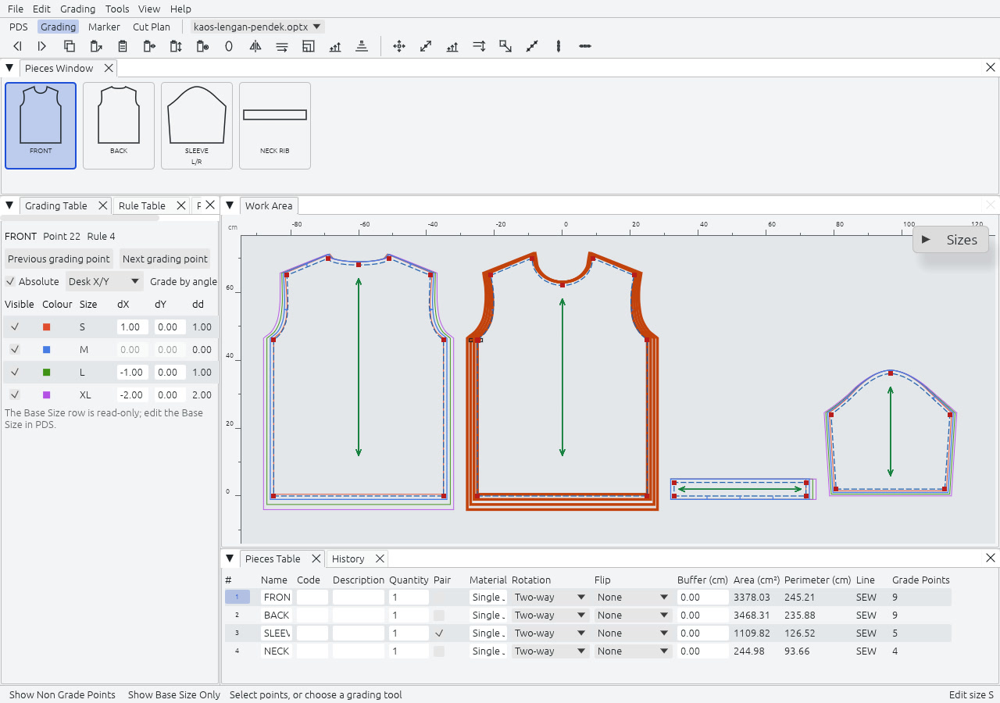

Rajutara men-grade berdasarkan aturan, seperti sistem aturan-titik pada rangkaian CAD lain. Sebuah style punya Size Table dengan tepat satu Base Size, dan Grade Rule, dX dan dY per ukuran, pada setiap Grade Point. Ukuran selain base tidak pernah digambar ulang: ukuran itu diturunkan dari base size oleh aturan. Base size adalah ukuran yang Anda gambar.

## Layar

Grading memakai style dan riwayat urungkan yang sama dengan PDS, dengan panel dan toolbar lain. Berpindah tab mempertahankan seleksi dan zoom.

| Panel | Isinya | Tombol |
|---|---|---|
| Work Area (Lembar Kerja) | Potongan, dengan graded nest terlihat. | |
| Grading Table | Aturan grade point terpilih: terlihat, warna, ukuran, dX, dY, dan dd (panjang perpindahan). | `2` |
| Rule Table | Aturan bernomor yang disimpan bersama style. | `Ctrl+Shift+Alt+R` |
| Properties, Pieces Table, History | Seperti di PDS. | `Ctrl+I`, `6` |

`F4` hanya menampilkan base size, dan `Ctrl+Shift+F4` menampilkan ukuran kecil, besar, dan base.

## Tabel ukuran

`Shift+F4` membuka Sizes Table. Ini dialog karena penyuntingan ukuran menyentuh semua aturan sekaligus.

- Sisipkan atau tambahkan ukuran. Delta baru melanjutkan langkah dua ukuran terdekat.
- Hapus ukuran saat ini, atau semua ukuran kecuali base.
- Ganti nama ukuran dan ubah urutannya. Nama berupa teks bebas tanpa spasi dan tidak bermakna bagi geometri.
- Set Base Size. Setiap titik berpindah ke posisinya pada ukuran yang dipilih dan setiap aturan diungkapkan ulang darinya.
- Tandai break size, lalu Regrade By Break Size: ukuran di antara dua break mengambil interpolasi linear dari break-nya.
- Beri setiap ukuran warna dan jenis garis. Ini hanya mengubah cara ukuran digambar.

Rajutara dibuat untuk satu dimensi ukuran hingga 12 ukuran. Program menerima hingga 99, batas yang melindungi memori pada build 32-bit.

## Tabel grading

Pilih grade point dan aturannya muncul. Ketik dX dan dY per ukuran. Sakelar Absolute memilih antara nilai yang dihitung dari base size, yaitu cara penyimpanannya, dan langkah dari satu ukuran ke ukuran berikutnya. Pemilih Grade by angle menampilkan angka yang sama sepanjang titik sebelumnya, titik berikutnya, atau tangen. Tombol panah berpindah antarsel, `Enter` menetapkan satu perintah, dan `Esc` mengembalikan sel.

Titik kontur tanpa aturan sendiri bergerak sebanding di antara grade point tetangganya. `Alt+1` mengalihkan grade point, dan menghapusnya menghapus aturannya setelah konfirmasi.

## 29 alat grading

| Grup | Alat |
|---|---|
| Copy and paste | Copy Grading (`Shift+C`), Paste Grading (`Shift+V`), Paste X (`Shift+X`), Paste Y (`Shift+Y`), Paste Relatively, Paste Grading Around |
| Set and clear | Set Grading, Flip Grading, Grade Equally, Clear Grading |
| Grade | Grade Along Line, Grade Proportional, Match Segment |
| Move one size | Move Point Size, Move Size Along, Move Size Proportional, Move Size by Rectangle, Move Size Parallel, Align Points Size, Align Vertical and Horizontal Size, Align Size by Line |
| Stack | Stack Point, Stack by Grainline, Restore Stack, Remove Grainline Grading |
| Rules | Rules Library, Apply Rule, Select Grade Points |
| Pieces | Create Piece for Selected Size, Graded Nest |

Stack Along Line tercantum dan dinonaktifkan sampai Fase 3. Menahan `Shift` saat memindahkan titik pada satu ukuran juga memindahkan ukuran yang lebih besar, dan `Ctrl` yang lebih kecil.

## Graded nest

Tampilan Graded Nest menggambar setiap ukuran dengan warnanya sendiri, diselaraskan pada Stack Point, dan tidak pernah mengubah geometri atau aturan. Graded Nest juga sebuah alat: ia membangun satu potongan ter-grade dari potongan per ukuran yang terpisah, untuk style yang diimpor dengan ukurannya sebagai potongan terpisah.

## Pertukaran

Style yang sudah di-grade keluar sebagai DXF ASTM D6673 ukuran sampel ditambah berkas ASTM RUL yang memuat aturan, atau sebagai graded nest dengan satu blok per ukuran. Keduanya bisa dibaca kembali. Sintaks RUL ditunjukkan di [Format berkas](../../formats/). Tabel aturan dalam format asli Optitex tidak dibaca atau ditulis.

Sistem ukuran multidimensi, cross grading dengan menggabungkan berkas style, dan bagan ukuran adalah Fase 3. Lihat [peta jalan](../../roadmap/).
