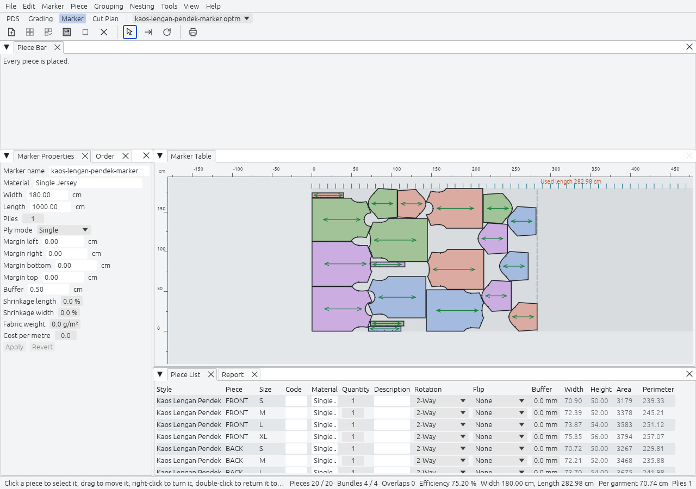
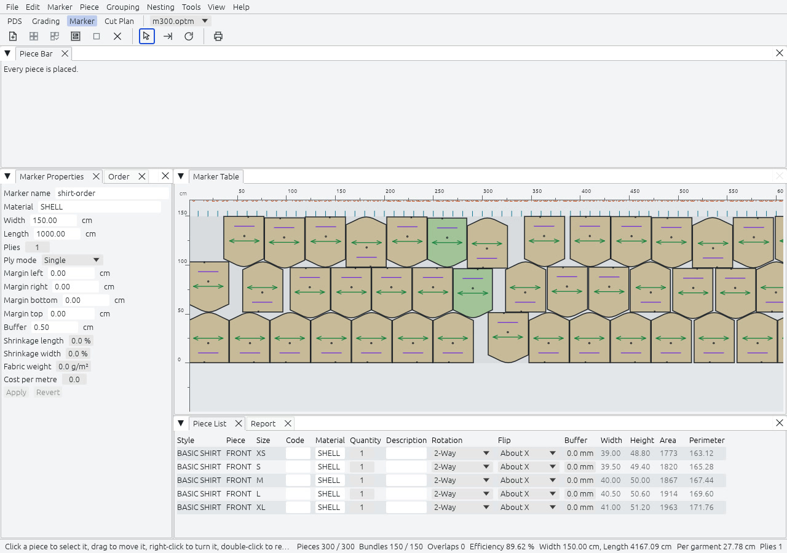

Marker adalah tata letak potongan satu style atau lebih dan satu ukuran atau lebih pada kain dengan lebar tertentu, siap diplot atau dipotong. Di ruang kerja ini Anda menentukan kain, meminta garmen yang dibutuhkan, menata potongan, dan membaca berapa kain yang dihabiskan tata letak itu.

## Layar

| Panel | Isinya |
|---|---|
| Marker Table | Pita kain, di tengah. X membentang sepanjang panjang marker, yaitu lusi, dan Y melintang lebarnya. Sebuah garis menunjukkan panjang terpakai beserta nilainya. Penggaris menandai setiap 10 cm. |
| Piece Bar | Satu thumbnail per style, potongan, dan ukuran, dengan jumlah yang masih harus ditata. Seret untuk mengurutkan ulang: urutannya menjadi benih nesting. |
| Piece List | Satu baris per potongan dan ukuran. Kode, material, jumlah, rotasi, balik, dan buffer bisa disunting; koordinat, luas, dan keliling hanya baca. |
| Marker Properties | Nama, material, lebar, panjang, lapis, mode lapis, margin, buffer, penyusutan, berat kain, dan biaya per meter. |
| Order | Bundle per ukuran, dan arah untuk setiap ukuran: One Way, Opposite, atau Any. |
| Report | Laporan sebelum ditulis. |

Marker Table mengisi setiap potongan dengan warna ukurannya, mengarsir tumpang tindih dengan merah, dan menggaris tepi oranye pada potongan yang berada di dalam margin.

Bilah status menjaga bidang berikut tetap hidup: posisi kursor, potongan yang ditata dari yang diminta, bundle lengkap dari yang diminta, tumpang tindih, efisiensi, lebar, panjang terpakai, panjang per garmen, lapis, dan kemajuan proses nesting.

## Penyiapan

File, New Marker (`Ctrl+N`) membuka Marker Properties. Lalu Marker, Add Style memilih berkas style, atau style yang terbuka di PDS; masing-masing disematkan di marker, jadi marker tetap berfungsi jika berkas style dipindahkan. Jika berkas style berubah kemudian, marker memberi tahu dan menawarkan Update from Style, yang mempertahankan pose potongan yang masih ada.

Di panel Order, ketik bundle per ukuran. Bundle adalah kumpulan potongan yang membuat satu garmen satu ukuran. Arah menentukan bagaimana potongan boleh berputar 180 derajat: One Way menjaga setiap bundle sama, Opposite berganti-ganti antarbundle, Any bebas.

## Tata dengan tangan

| Untuk | Lakukan ini |
|---|---|
| Menata potongan | Seret thumbnail ke meja, atau klik ganda. Klik ganda menempatkannya di tempat kosong pertama, kiri bawah. |
| Memindahkannya | Seret. Tumpang tindih diizinkan dan ditampilkan. |
| Mengembalikannya ke bar | Klik ganda pada potongan yang sudah ditata. |
| Memutar atau membalik | Klik kanan pada potongan. Potongan melangkah ke orientasi berikutnya yang diizinkan aturannya. |
| Menembak (Shoot) | Klik kanan dan seret ke satu arah, lalu lepas. Potongan meluncur sampai menyentuh potongan lain, margin, atau tepi kain, dengan mempertahankan buffer. |
| Menggeser sedikit | Tombol panah, atau angka 2, 4, 6, dan 8. Langkahnya 1 mm kecuali Preferences menentukan lain. |
| Menata semua | Tombol toolbar menata setiap potongan yang belum ditata, kiri bawah lebih dulu. |
| Mengosongkan marker | `Ctrl+C` mengembalikan setiap potongan ke bar. `Ctrl+Z` mengembalikannya. |

## Auto-nesting

Nesting, Start Auto Nesting (`F9`) menata potongan untuk Anda. Mesinnya milik Rajutara sendiri: ia membangun no-fit polygon dengan ring convolution, mengisi dari kiri bawah, dan memperbaiki hasil dengan simulated annealing, mengikuti metode terbitan Burke dan kawan-kawan. Mesin berjalan di thread pekerja, menampilkan kemajuannya di bilah status, dan punya tombol Cancel. Dokumen berubah sekali, dengan satu perintah, saat proses berakhir.

| Pengaturan | Bawaan | Arti |
|---|---|---|
| Time limit | 60 detik | Batas waktu dinding yang keras. |
| Efficiency limit | mati | Berhenti lebih awal ketika marker mencapainya. |
| Unlimited marker length | nyala | Abaikan panjang maksimum saat nesting. |
| Keep placed pieces | nyala | Nesting potongan yang belum ditata di sekitar yang sudah ditata. |
| Seed | 1 | Membuat satu proses bisa diulang. |

Proses yang berhenti karena batas waktu bergantung pada kecepatan mesin. Dalam tolok ukur rilis, 300 potongan di-nesting dalam 58 detik dengan efisiensi 90,1 %. Mesin tidak pernah meninggalkan tumpang tindih pada hasilnya, dan pemeriksaan eksak terpisah memastikannya.

## Arti angka-angkanya

- **Used length**: X terbesar dari garis potong mana pun yang ditata, ditambah margin kanan.
- **Efficiency**: luas potongan yang ditata dibagi lebar kali panjang terpakai, dalam persen.
- **Waste area**: lebar kali panjang terpakai, dikurangi luas yang ditata.
- **Per garment**: panjang terpakai dibagi bundle lengkap yang ditata.

Marker kaos contoh terbaca 253,03 cm terpakai pada lebar 180 cm, efisiensi 84,10 %, dan 63,26 cm per garmen.

## Laporan dan plot

File, Report to Excel menulis CSV UTF-8 dan File, Report menulis PDF, keduanya dengan bagian yang sama: angka umum, order, setiap potongan, dan notch menurut bentuk. `Ctrl+L` memplot: PDF di lembar A0, berubin sepanjang panjangnya ketika marker lebih panjang dari satu lembar, atau berkas HPGL/2 untuk plotter gulungan, dengan label pada setiap potongan dan blok header berisi nama marker, material, lebar, panjang, dan efisiensi. File, Export Cut File menulis satu berkas potong HPGL/2 generik: label di pena 1, lubang bor di pena 3, bagian dalam yang dipotong dan garis potong di pena 2, potongan menurut urutan posisi.

## Belum ada di 1.0

Cluster pieces, delete cluster, fix on marker, block fuse, substitute size, dan antrean nesting adalah Fase 3. Mode lapis selain tunggal, alat teks, cutting order, optimize cut order, dan garis bump atau potong belum dirilis di ruang kerja Marker. Lihat [peta jalan](../../roadmap/).
