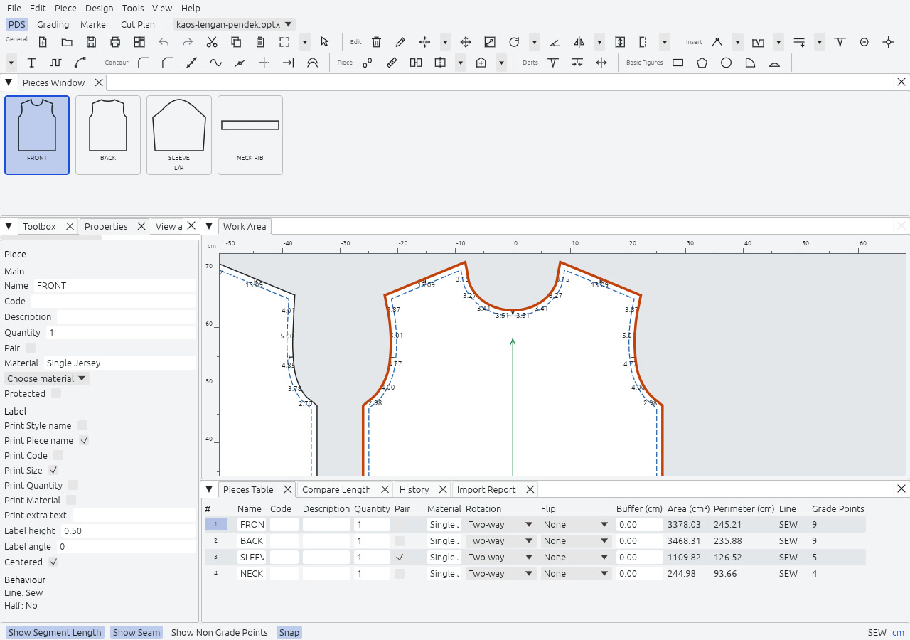

PDS adalah tempat potongan berasal. Impor dari DXF ASTM atau AAMA, atau gambar sendiri, lalu sunting titik, penandaan, kampuh, dan garis dalam, periksa panjang segmen, dan plot potongan pada skala 1:1.

## Layar

Panelnya adalah tab dock. Seret tab untuk memindahkannya, dan Tools, Reset Workspace Layout mengembalikan susunan bawaan. Ruang kerja mengingat tata letaknya sendiri, dan tata letak yang disimpan versi sebelumnya tetap berfungsi.

Sejak 1.5.0 tata letak bawaan memberi Work Area sebagian besar jendela: kolom Toolbox di kiri, Work Area di tengah, Properties di kolomnya sendiri di kanan, dan satu panel bawah dengan Pieces Window sebagai tab pertamanya. Pada 1280×800 Work Area berukuran sekitar 745×395 px. Memilih sesuatu tidak lagi menyembunyikan Toolbox. Tanpa dokumen terbuka, Work Area menampilkan tombol New dan Open….

| Panel | Isinya | Tombol |
|---|---|---|
| Work Area (Lembar Kerja) | Meja tempat potongan berada. Tidak bisa ditutup. | |
| Pieces Window | Tab pertama panel bawah. Satu thumbnail per potongan, dengan nama, jumlah, dan `L/R` untuk sepasang. Seret satu ke meja, atau klik ganda. | `1` |
| Toolbox | Alat-alat, dikelompokkan seperti di toolbar. | `3` |
| Properties | Kolomnya sendiri di kanan. Bidang potongan, titik, segmen, atau penandaan yang dipilih. Beberapa potongan bisa disunting sekaligus. | `Ctrl+I` |
| View and Selection | Apa yang ditampilkan dan apa yang bisa dipilih. | `F10` |
| Grading Table | Aturan grade titik yang dipilih. | `2` |
| Pieces Table | Setiap potongan dalam grid: nama, kode, jumlah, pasangan, material, rotasi, balik, buffer, luas, keliling. | `6` |
| Compare Length | Dua ruas kontur, diukur satu terhadap yang lain. | `5` |
| History | Riwayat urungkan, dipakai bersama ruang kerja lain. | |
| Import Report | Masalah impor terakhir. Terbuka bila ada. | |

Bilah status mengalihkan panjang segmen (`F8`), kampuh (`Ctrl+F6`), Non Grading Points (`Shift+0`), ukuran ter-grade (`F4`), Snap (`F7`), Dynamic Input, dan Polar Tracking. Grade Point selalu digambar; sakelar Non Grading Points menambahkan titik lainnya. Snap mati mematikan snapping untuk setiap alat. Di kanan, bilah status menampilkan `Protected` untuk potongan yang terkunci, `SEW` atau `CUT` untuk garis yang disunting, satuan (klik untuk bergilir antara sentimeter, milimeter, dan inci), dan posisi kursor.

## Di meja

- **Warna.** Setiap potongan mendapat isian sendiri dari palet 12 warna: pastel pada tema terang, warna pekat pada tema gelap. Potongan mempertahankan warnanya di setiap ukuran dan ruang kerja. View, Fill with Color mematikan isian.
- **Hover dan seleksi.** Apa yang akan kena klik mendapat cincin atau garis tepi merah, seperti Optitex menampilkan snap-nya. Seleksi tetap oranye. Alat yang butuh titik kedua menggambar garis karet putus-putus dari pilihan pertama, dengan Length, Angle, dX, dan dY di samping penunjuk.
- **Piece Information Text.** View, Piece Information Text menampilkan bidang label setiap potongan di meja, satu per baris. Plot mencetak baris yang sama.
- **Menu klik kanan.** Objek di bawah penunjuk dipilih lebih dulu, lalu menu menawarkan apa yang berlaku untuknya. Menu potongan dan titik punya submenu Grading (Sizes Table, Set Grading Tool, Copy Grading, Paste Grading). Garis dalam, lubang bor, dan anotasi menawarkan Copy Internal Object dan Move Or Copy Internal Tool.
- **Spasi memindahkan potongan.** Dengan alat apa pun aktif dan tanpa tombol mouse ditekan, tahan `Space` untuk memindahkan potongan di bawah penunjuk; `Ctrl+Space` memindahkan objek dalam di bawah penunjuk. Melepas Space menjatuhkannya sebagai satu langkah urungkan, dan alat yang aktif tetap aktif. Potongan terlindungi ditolak.
- **Tombol.** `Enter` pada seleksi membuka propertinya: Point Properties untuk titik terpilih, selain itu Piece Properties. `Del` dengan Select menghapus sub-objek terpilih, atau jika tidak ada, mengeluarkan potongan dari Work Area. `Shift+Del` menghapus potongan.

Segmen terpilih, atau dua titik bersebelahan yang terpilih, menampilkan bagian Segment di Properties: panjangnya, Sew atau Cut, dan Straight atau Curve.

## Alat

Ada 101 alat, dalam kelompok yang dipakai toolbar dan menu.

| Grup | Contoh |
|---|---|
| General | Select (`Z`), zoom dan pan, garis panduan, properti potongan, kunci potongan (`F3`), potong, salin, dan tempel potongan, gabung berkas style |
| Piece movement and rotation | Pindah, putar (`R`), putar ke horizontal atau vertikal, balik, Save Placement dan Restore Placement |
| Grainline and half symmetry | Atur arah Garis Serat (`/`), atur separuh (`H`), buka dan tutup separuh (`Shift+H`, `Ctrl+H`) |
| New pieces | Potongan persegi panjang, poligon, lingkaran, sektor, dan busur, spiral, potongan dari zona sebuah map |
| Drafting and points | Draft (`D`), busur (`A`), tambah titik pada kontur (`O`), pindah titik (`M`), multi move (`Q`) |
| Contour | Align points, round corner, cut corner, smooth, points cleanup, Extend dan Extend in Parallel, Wave Tool, Segment Editor, Equal Segments |
| Notches and internals | Notch (`N`), penandaan pada titik, teks, trim, extend, pindah dan pilih garis dalam, Deform Internals |
| Seams | Add seam (`S`), remove seam, reseam, show seam, beralih antara cut dan sew, Set Basic Seam, sudut kampuh Custom |
| Split, join and fold | Cut, gabung potongan, gabung kontur, bangun potongan, trace segmen, Fold Line to Line |
| Darts, pleats and fullness | Dart (`Ctrl+Alt+D`), pleat (`L`), add fullness, gusset, Reopen Darts |
| Piece properties | Swap Piece Properties, warna per potongan, label satu baris, Spread dan Gather Pieces, Fabric And Stripes, Track Lines |

Tekan `Ctrl+Shift+P` untuk mencari alat berdasarkan nama, bukan tombol. Alat yang butuh beberapa klik menampilkan langkah berikutnya di bilah status, dan `Esc` membatalkannya. Menahan `Alt` saat mengklik membuka dialog untuk nilai yang tepat. Setiap alat punya penunjuknya sendiri: ikonnya pada crosshair, silang pindah di atas potongan yang akan diseret Move Piece, dan tanda dilarang di atas potongan terlindungi.

Setiap penandaan punya bentuk (V, T, I, L, U, atau Box), kedalaman, dan lebar. I adalah celah lurus. Garis Serat adalah garis berarah yang dipakai marker untuk memutar potongan sepanjang kain. Kampuh punya lebar per segmen: kontur potong adalah kontur jahit ditambah kampuh.

[Daftar paritas](../../parity-checklist/) mencantumkan seluruh 101 alat satu per satu. Di dalam submenu, item menampilkan keterangan Optitex bila berbeda dari nama alat, misalnya Piece, Info atau Contour, Smooth Segment; toolbar, tooltip, palet perintah, dan menu klik kanan tetap memakai nama lengkap.

## Menggambar dengan nilai yang diketik

Dynamic Input dan Polar Tracking adalah dua sakelar di bilah status dan di menu View. Rajutara menyimpan keduanya di preferensi.

- **Dynamic Input** (bawaan nyala). Selama Draft menunggu titik berikutnya, ketik Length, tekan `Tab` untuk beralih ke Angle, dan tekan `Enter` untuk menempatkan titik. `Shift+Enter` menempatkan Curve Point. `Esc` mengosongkan yang diketik. Selama Draft menunggu angka, pintasan angka diam.
- **Polar Tracking** (bawaan mati). Titik di dekat sinar 45°, atau di dekat garis tegak lurus segmen terakhir, mendarat pada sinar itu. Sinar putus-putus menampilkan sudutnya.

Alat lain tetap memakai dialog `Alt+klik`.

## Titik dan penandaan

- **Add Point on Contour** (`O`) menampilkan tempatnya, jarak dari titik sebelumnya, jarak ke titik berikutnya, dan rasionya sebelum Anda mengklik. Untuk titik di tengah segmen, `Alt+klik` dan pilih Proportional 0.5. Add Point at Midpoint sudah dihapus, karena Optitex tidak punya perintah itu.
- **Point Name.** Dialog Add Point on Contour punya bidang Point Name. Point Properties punya baris Name untuk titik kontur dan titik Internal Line yang terpilih. Namanya disimpan di `.rjx`. Nama tidak digambar dan tidak ditulis ke DXF.
- **Celah di tengah segmen.** Aktifkan Notch Tool dan `Alt+klik` segmennya. Di Notch Properties pilih Type I, sebuah Depth, Direction Perpendicular, dan Relationship Proportional dengan 0.5. Plot, DXF (layer 4), dan berkas potong membawanya sebagai penandaan celah.
- **Move Point dan Move Point Along Contour** bekerja dengan klik, klik atau dengan tekan, seret, dan lepas. Kontur baru tampil sebagai garis tepi putus-putus sementara yang lama meredup.

## Menyunting banyak potongan sekaligus

- **Global Piece Info** (menu Piece) memilih setiap potongan di meja. **Global Internal** memilih setiap garis dalam pada potongan terpilih, atau pada semua potongan bila tidak ada yang dipilih. Panel Properties lalu menyunting semuanya bersama dan menampilkan "Different" bila nilainya berbeda. Satu suntingan adalah satu langkah urungkan.
- **Set Basic Seam** (Tools, Seam) memberi satu lebar kampuh pada seluruh kontur setiap potongan terpilih, dalam satu langkah urungkan.
- **Swap Piece Properties Tool** (Piece, General) memberi dua potongan terpilih nama, kode, deskripsi, jumlah, pasangan, material, label, dan aturan Marker satu sama lain. Bentuknya tetap di tempat.

## Sudut kampuh

Seam Corner, bidang sudut Seam Tool, dan Point Properties menawarkan Intersect, Bevel, Square, Mirror, dan Custom. Custom menanyakan Depth A dan Depth B, mula-mula 5 mm.

## Kontur dan garis dalam

- **Extend in Parallel** ada di toolbar Contour, di samping Extend. Setelah Anda memilih titik pertama dan terakhir dari tepinya, alat ini menanyakan jarak: nilai positif memperpanjang, nilai negatif memangkas.
- **Extend Internal Object** terbuka pada bidang jumlah dengan "By an extension amount" terpilih, jadi panjang yang diketik langsung dipakai. Klik pada segmen kontur ditolak dengan petunjuk ke Extend in Parallel.
- **Wave Tool** (toolbar Insert, Design, Contour). Klik titik pertama dan terakhir, gerakkan penunjuk untuk tingginya, lalu klik. Bawaannya dua gelombang; `Tab` menambah satu dan `Shift+Tab` mengurangi satu. `Alt` pada klik ketiga membuka dialog: Waves, Internal Points On Wave, Height, Angle, dan New Wave atau Contour Change. Di antara dua titik kontur satu potongan, alat ini membentuk ulang kontur; di tempat lain ia menambahkan garis dalam.
- **Deform Internals** (Design, Deform Internals) punya Transform Circle To Contour, Transform Circle To Button, dan Transform Button To Circle, masing-masing satu langkah urungkan.
- **Fold Line to Line Tool** (Piece, Modify) melipat potongan sehingga salah satu garisnya mengambil arah garis lain.
- **Reopen Darts** (Tools, Darts) membuka setiap kup yang ditampilkan tertutup oleh Close Dart.

## Segment Editor

Tools, Segment Editor punya papan klipnya sendiri. Copy (`Ctrl+G`) mengambil deret terpilih, atau seluruh kontur bila satu titik terpilih. Flip X, Flip Y, dan Inverse memutar salinannya, dan Use Grading serta Use Notches memilih apa yang ikut. Paste Proportional, Paste Between 2 Points, Paste Notches, dan Paste As Internal Contour masing-masing menempel dalam satu langkah urungkan, dan lebih dulu menampilkan deret yang disesuaikan di bawah penunjuk. Tidak ada panel Segment Editor dan tidak ada Use Darts.

## Track Lines

Tools, Track Lines, Track Lines (`Ctrl+Alt+T`) mengingat setiap potongan. Potongan yang Anda ubah lalu menampilkan kontur dan objek dalam lamanya sebagai bayangan tipis putus-putus, selama Show Track Lines (`Ctrl+Shift+Alt+T`, juga di View and Selection) nyala. Restore By Track Line mengembalikan bentuk lama dalam satu langkah urungkan, dan Clear Track Lines (`Ctrl+T`) mulai lagi dari bentuk saat ini. Track line bertahan selama sesi dan tidak disimpan.

## Equal Segments

Design, Equal Segments, Definition… (`Ctrl+Alt+Q`) mengelompokkan dua deret terpilih atau lebih. Grup menjaganya tetap sama panjang saja, atau juga sama bentuk, secara proporsional bila diminta, dengan Fix Last Point, Mirror, Inverse, dan sebuah warna. Setelah setiap suntingan, deret lain mengikuti deret yang Anda ubah, dalam langkah urungkan yang sama. Deret pada potongan terlindungi dilewati dengan pemberitahuan. Show With Color menggambar setiap grup dalam warnanya.

## Zona dan map piece

Map piece adalah sketsa datar garmen yang area-areanya menjadi potongan sebenarnya. Design, Internal to Piece punya Build Zone Tool, tempat Anda mengklik di dalam sebuah area, dan Trace Zone Tool, tempat Anda mengklik deret di sekelilingnya. Create Pieces From Map membuat satu potongan per zona. Ketika map berubah, Correct All Pieces By Map membangun ulang potongan itu dan mempertahankan propertinya.

## Kain, belang, dan potongan yang di-spread

- **Fabric And Stripes** (Piece, Fabric And Stripes). Fabric Pattern… menyimpan ulangan dan celah belang kain, dan View Fabric menggambar grid belang. Set Stripes Group dan Stripes Ungroup memberi nomor pada potongan yang berbagi satu pencocokan belang, dan Relate Piece To Stripes menandai titik potongan yang berada di garis belang. Marker belum mencocokkan belang.
- **Spread Pieces** (menu yang sama) menampilkan salinan di samping potongan untuk setiap jumlah dan pasangan berikutnya, salinan pasangan dicerminkan, di Work Area dan di plot. Arrange For Plot menyisakan tempat untuknya. Gather Pieces menghapusnya.

## Penempatan, warna, dan label

- **Save Placement** (Piece, General) memberi setiap potongan di meja Fixed Placement. **Restore Placement** memindahkan potongan yang tetap kembali ke tempatnya. Perintah ini membatalkan pindah, putar, dan balik, tetapi bukan suntingan titik, dan mengeluarkan potongan lain dari meja. Fixed Placement juga berupa centang di Piece Properties.
- **Color** di Piece Properties memilih isian potongan terpilih dalam satu langkah urungkan. Auto kembali ke warna palet.
- **One line** di Piece Properties mencetak deskripsi dalam satu baris, digabung dengan Separator. Work Area, plot, dan label DXF mengikutinya. Dengan Text Tool, seret deskripsi potongan untuk memindahkannya, atau `Alt+klik` untuk mengatur tinggi dan sudutnya.

## Walk dengan penandaan penopang

Walk Options punya Support Notch (bawaan nyala), Type-nya, dan Command-nya (Cut lebih dulu). Saat berjalan, klik kontur potongan ketiga untuk berjalan terus di sepanjangnya, mulai dari verteksnya yang terdekat dengan sambungan. Potongan yang bergerak mendapat penandaan di sambungan, dalam satu langkah urungkan "Support notch". Reconnect dan Grading Walking belum dibuat.

## Impor dan ekspor

File, Import From CAD/CAM Files membaca berkas DXF ASTM D6673 dan AAMA-292, dengan berkas RUL untuk style yang sudah di-grade. File, Export To CAD/CAM Files menulisnya kembali, dengan pilihan antara berkas aturan (bawaan) dan graded nest. Layer demi layer, DXF dijelaskan di [Format berkas](../../formats/). Rajutara tidak pernah membaca atau menulis format Optitex sendiri.

File, Report to Excel menulis workbook Excel, `<style>.xlsx`, dengan potongan, kode, ukuran, jumlah, material, luas, serta keliling potong dan jahit.

## Cadangan

Setiap simpan menyimpan berkas sebelumnya sebagai `.bak`. File, Open Backup membuka `.bak` dari Style yang terbuka, atau dari Style yang Anda pilih, sebagai dokumen baru yang belum disimpan. Save lalu menanyakan tempat menulis, jadi cadangannya tidak tertimpa. Perintah ini nonaktif, dengan alasannya, bila tidak ada cadangan.

## Plot

`Ctrl+L` membuka dialog Plot.

| Bidang | Pilihan |
|---|---|
| Pieces | Semua, di meja, atau terpilih. Terpilih jika ada seleksi, selain itu di meja. |
| Sizes | Daftar centang ukuran, dan apakah ukuran di-nesting dalam satu set garis tepi. |
| Elements | Garis potong, garis jahit, garis dalam, penandaan, lubang bor, Garis Serat, garis cermin, anotasi, label potongan. |
| Target | PDF sebagai ubin A4 (bawaan), PDF di A0, atau berkas HPGL/2. |
| Arrange first | Menata potongan pada lebar lembar sebelum memplot. |

Garis potong diplot padat dan garis jahit putus-putus, penandaan digambar sebagai bentuknya pada garis potong, dan Garis Serat punya kepala panah. Label potongan mencetak setiap bidang label secara berurutan, satu per baris. Arrange for Plot (`Ctrl+K`) mengerjakan tata letak sendiri: potongan diurutkan menurut tinggi, ditata dalam baris dari kiri ke kanan dengan celah (bawaan 10 mm), dan diputar 90 derajat ketika potongan panjang tidak muat pada lebar. Plot berjalan di thread pekerja dengan kemajuan dan tombol Cancel.

## Belum dibuat

- Panel Segment Editor dan Use Darts-nya.
- Snap To Track Lines, dan sakelar Track Lines di bilah status.
- Jendela grup Equal Segments dan Equal Segments, Options.
- Swap Zone Segment Tool dan Move Piece On Piece Tool: tidak ada keterangan publik tentang apa yang dilakukannya.
- Seam and Stitch Manager, yang merupakan bagian dari 3D.
- Pencocokan belang dan kotak-kotak di Marker. PDS sudah menyimpan data belangnya.

[Peta jalan](../../roadmap/) memuat daftar lengkapnya.
